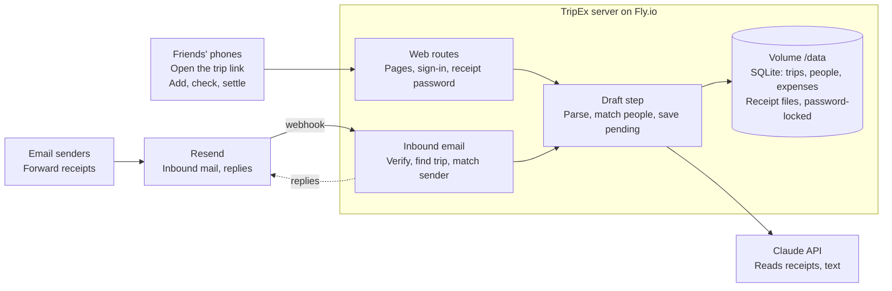

# TripEx: Product & Technical Spec

As of Oct 17, 2026

TripEx is a web app for splitting group trip costs: one link shared in the group's WhatsApp chat, expenses added by typing, photo, PDF or email, and a live settle-up. This spec describes the app as built.

## Overview

TripEx runs as a single Node server with a SQLite database. Friends need no accounts and no app: everything happens through the trip link.

- **Who it's for:** a group of friends on a trip, coordinating in a WhatsApp group.
- **What it does:** captures expenses, keeps a cent-exact ledger, and shows the fewest payments to settle up.
- **What it doesn't do:** move money. Settle-up says who pays whom; people pay through Venmo, Zelle or cash.
- **Currency:** US dollars only. Non-USD receipts are flagged for a manual USD amount.
- **Nothing counts until checked:** every captured expense starts as a draft that a person reviews and saves.
- **Parked:** a WhatsApp bot channel exists in the code and switches on only when `WHATSAPP_TOKEN` is set. Meta's business setup proved too hard, so the web app is the product.

## How people use it

1. **Start.** The creator enters a trip name and the people going: their own row first, then **+ Add person** per friend. Every row needs a name and an email. An optional access code (`CREATE_PIN`) gates this page.
2. **Share.** The trip page has *Share in WhatsApp* and *Copy link*. The link carries a secret key: `/t/<CODE>?k=<key>`.
3. **Join.** A friend opens the link and taps their name, or adds themselves with name and email. Tapping a name always asks for that person's email: saved the first time, and it must match after that. The creator also needs the receipt password.
4. **Add.** Type an expense (`dinner 142 skip Raj`), upload a receipt photo or PDF, or email the trip's own address.
5. **Check.** Each draft opens on a review form: description, amount, who paid, who's in, and share weights. Save, discard, or later edit and delete.
6. **Settle.** The trip page shows totals, each person's balance bar, and the fewest transfers to square up.
7. **Unlock receipts.** Receipt files open only for the creator and for people who enter the trip's receipt password on their device.
8. **Remove someone.** The trip owner can remove anyone but themselves, after a confirmation page that shows that person's email or says there's none on file. It's blocked while that person is on a saved expense, so balances never change silently. Unsaved drafts they paid for are discarded, they're dropped from other drafts, their devices are signed out, and their email can't rejoin or re-add them by emailing the trip.
9. **Export.** The trip owner downloads a .zip: `trip.json` (versioned, built for a future import), `expenses.csv`, `people.csv`, `settle-up.csv`, a plain-text summary, and every receipt file. See [EXPORT.md](EXPORT.md).

## Architecture

Phones and emails take different doors into the same draft step, which calls Claude and saves a pending expense to the database on the server's volume. Resend also carries TripEx's confirmation replies back to senders.

## Expense capture

Every input path ends in the same step (`createDraft`): parse, resolve people, save a pending expense with a note explaining anything to fix. AI problems never block a draft; the form is just less filled in.

| Input | How it's read | Kept as receipt |
| --- | --- | --- |
| Typed text | Claude, or the offline parser if no API key | No |
| Photo (JPG, PNG, WebP, GIF) | Claude vision | The image |
| PDF | Claude document input | The PDF |
| Email with attachment | Claude reads attachment plus body | First readable attachment |
| Email, text only | Claude, or offline parser for short notes (300 characters or less) | The email text, addresses hidden |

- **Claude call:** one `record_expense` tool with a strict schema (all fields required, empty string means not stated) and `tool_choice: auto`, since Sonnet 5.5 rejects forced tool choice. Default model `claude-sonnet-5-5`.
- **Fields read:** is_expense, amount, currency, description, payer, split mode (everyone, only, except), people, weights, line items, note.
- **Offline parser:** amounts, "skip X", "except X", "just/only/split with/between X", "with Sara and Anir", "X paid", and description cleanup.
- **People named but not on the trip:** for "only" splits ("dinner with Sara and Anir"), plausible names are added as members without email; they're asked for one when they open the link. Names after skip/except are never added.
- **Unsupported files:** HEIC and other types get a clear note asking for a screenshot. Friendly messages map API errors (bad key, no credit, rate limit, too large).

## Email receipts

Each trip has its own address, `<trip-code>.<8-hex secret>@<INBOUND_DOMAIN>`, shown on the trip page. Emails to it become drafts under **From email, waiting for a check**.

1. **Receive.** Resend posts an `email.received` webhook to `/inbound/resend` (Svix-signed). TripEx then fetches the full email and attachments from Resend's API. Postmark is supported as an alternative (`/inbound/postmark?secret=`).
2. **Find the trip.** From the recipient's local part or plus-tag; unknown addresses are accepted and ignored.
3. **Clean the text.** Signatures, "Sent from my iPhone", quoted replies and "On ... wrote:" blocks are stripped; forwarded messages are kept.
4. **Match the sender.** By email first, then by name for members without an email. Otherwise a new member is added from the sender's display name, but only if the email becomes an expense. Automated senders (no-reply and similar) are never added; their receipts are credited to the creator.
5. **Draft.** The shared capture step runs with the subject, body and attachments.
6. **Reply (optional).** If `REPLY_FROM` is set, the sender gets a threaded reply via Resend: "Got your receipt" with the amount read, a check link and the trip link, or a note that no receipt was found. Never sent to no-reply addresses.

Replies need a domain verified in Resend. Until then, `onboarding@resend.dev` only delivers to the Resend account owner.

## Security and privacy

The trip link is the main secret; receipts and the creator's identity sit behind a second, per-trip password.

| Area | Control |
| --- | --- |
| Trip access | Random 16-character key in the link, compared in constant time; wrong key returns 404 |
| Starting trips | Optional access code (`CREATE_PIN`, 6 digits from `deploy.sh`); 5 wrong tries per device, 50 overall, per 15 minutes |
| Sign-in | No accounts. Tapping a name requires that person's email (saved first time, must match after). Error never reveals the stored email |
| Cookies | HttpOnly, SameSite=Lax, Secure behind HTTPS, HMAC-signed with a server secret kept in the database. Old unsigned cookies accepted for 14 days, never for the creator |
| Receipt files | Per-trip receipt password (e.g. `cedar-lagoon-47`), visible only to the creator. Others unlock per device for 30 days. Changing it relocks every device |
| Creator sign-in | New device needs the creator's email and the receipt password |
| Guessing | Wrong emails and passwords share a limit: 8 per device and 30 per trip every 15 minutes |
| Receipt downloads | `Cache-Control: private, no-store`, `nosniff`; email copies served as plain text only |
| Email addresses | Never shown in the app, except one person's email to the trip owner on the remove confirmation page (not cached), and in the owner's export. Notes use names; stored email copies replace addresses with "[email hidden]"; logs mask them (`a***@gmail.com`) |
| Inbound email | Resend webhooks verified with Svix HMAC and a 5-minute window; Postmark with a shared secret; 8-hex secret in each trip address |
| Pages | `noindex`, `Referrer-Policy: no-referrer` so trip keys don't leak to other sites |
| Secrets | API keys live only in Fly secrets; `deploy.sh` reads the Anthropic key without echoing it. No secrets in the code |

Recovery: `npm run receipt-password -- <CODE>` on the server prints a trip's password if the creator loses it.

## Data model

SQLite via Node's built-in `node:sqlite`. Money is stored in integer cents. A migration step on startup adds new columns to older databases.

| Table | Key columns | Notes |
| --- | --- | --- |
| users | id (`w_` + random for web users), name, email | Email stored lowercase |
| trips | code, name, created_by, view_token, email_token, receipt_pin | Code like `TAHOE-X7Q` |
| members | trip_id, user id | Who is on which trip |
| expenses | payer, amount_cents, description, source, status, items, receipt_file, note, created_by | Source: text, receipt, email. Status: pending, confirmed, cancelled, deleted |
| shares | expense_id, user id, weight | Weight 0 means sat out; 2 means covering two people |
| settings | key, value | Holds the cookie-signing secret and when signed cookies started |
| removed_emails | trip_id, email | People the owner removed; their emails are ignored and can't rejoin |

- **Splits:** weighted, with largest-remainder rounding so shares always add up to the exact cent total.
- **Settle-up:** net balances, then a greedy match of biggest debtor to biggest creditor for the fewest transfers.
- **Receipt files:** stored on disk under `RECEIPTS_DIR/<trip code>/`, never served statically.

## Routes

All trip routes need the link key (`?k=`); most also need a signed-in member.

| Method | Path | Purpose | Who |
| --- | --- | --- | --- |
| GET | `/` | Start-a-trip form | Anyone |
| POST | `/` | Create trip and members | Anyone with access code |
| GET | `/t/:code` | Trip page, or join page if not signed in | Link holders |
| POST | `/t/:code/join` | Tap a name (email check) or join as new | Link holders |
| GET | `/t/:code/leave` | Sign out on this device; relocks receipts | Members |
| POST | `/t/:code/expenses` | Add from text or upload, then review | Members |
| GET | `/t/:code/e/:id` | Review or edit an expense | Members |
| POST | `/t/:code/e/:id` | Save, discard or delete | Members |
| POST | `/t/:code/unlock` | Enter receipt password | Members |
| POST | `/t/:code/receipt-password` | Pick a new receipt password | Creator |
| GET | `/t/:code/export` | Download the trip as a .zip | Creator |
| GET | `/t/:code/people/:id/remove` | Confirm removal; shows their email | Creator |
| POST | `/t/:code/people/:id/remove` | Remove someone from the trip | Creator |
| GET | `/t/:code/r/:id` | Download a receipt file | Creator, or unlocked members |
| POST | `/inbound/resend` | Resend email webhook | Svix-signed |
| POST | `/inbound/postmark` | Postmark email webhook | Shared secret |
| GET | `/health` | Health check for Fly | Anyone |
| GET/POST | `/webhook` | WhatsApp bot (parked) | Meta, only if enabled |

## Configuration

Set as Fly secrets in production, or in `.env` locally (`.env.example` lists them all, empty).

| Variable | Required | Purpose |
| --- | --- | --- |
| `ANTHROPIC_API_KEY` | For AI reading | Claude parses text, photos, PDFs, emails |
| `CLAUDE_MODEL` | No | Default `claude-sonnet-5-5` |
| `PUBLIC_URL` | Yes in production | Base for links in emails, e.g. `https://tripex-app.fly.dev` |
| `CREATE_PIN` | Recommended | Access code to start trips |
| `INBOUND_DOMAIN` | For email (Resend) | Resend receiving domain, e.g. `abc123.resend.app` |
| `RESEND_API_KEY` | For email (Resend) | Fetch inbound emails, send replies |
| `RESEND_WEBHOOK_SECRET` | For email (Resend) | Verify webhooks (`whsec_...`) |
| `REPLY_FROM` | No | Sender for confirmation replies |
| `INBOUND_ADDRESS`, `INBOUND_SECRET` | For email (Postmark) | Alternative inbound provider |
| `DB_PATH`, `RECEIPTS_DIR`, `PORT` | No | Storage paths (`/data` on Fly) and port |
| `WHATSAPP_*`, `BOT_PHONE_NUMBER` | No | Parked WhatsApp bot |

## Hosting, operations and testing

One always-on Fly.io machine (app `tripex-app`, region `iad`) with a 1 GB volume at `/data` for the database and receipts.

- **Stack:** Node 22.13+, TypeScript (strict) run with `tsx`, Express 4, multer (uploads up to 10 MB), `@anthropic-ai/sdk`. About 2,800 lines of TypeScript.
- **Deploy:** `bash deploy.sh` installs flyctl if needed, logs in, creates the app and volume, asks for the Anthropic key (hidden), sets secrets and a 6-digit access code, then runs `fly deploy --ha=false`. Safe to re-run; data is kept.
- **Pages:** server-rendered HTML, no client framework. Bricolage Grotesque and IBM Plex Sans, sage and plum palette, dark mode.
- **Backups:** Fly volume snapshots (`fly volumes snapshots list`).
- **Tests:** ledger unit tests (`npm test`) plus end-to-end curl suites run against a real server with stand-ins for Claude and Resend: web flow, Postmark, Resend, people and replies, trip creation, named people, receipt password, removing people, export, and a privacy scan that crawls every page for email addresses. About 230 checks, all passing. The end-to-end suites aren't in this repo yet.
- **Not yet tested live from the build sandbox:** real Claude responses and real Resend delivery. Those are checked on the deployed app.

| File | Role |
| --- | --- |
| `src/server.ts` | App setup, health check, routers |
| `src/web.ts` | Web routes, sign-in, receipt password |
| `src/views.ts` | Page templates and styles |
| `src/drafts.ts` | Shared input-to-draft step |
| `src/ai.ts` | Claude call and offline parser |
| `src/inbound.ts` | Inbound email and replies |
| `src/ledger.ts` | Splits, balances, settle-up |
| `src/db.ts` | Schema, migrations, data access |
| `src/util.ts` | Links, receipt storage, email hiding |
| `src/export.ts`, `src/zip.ts` | Trip export and zip builder |
| `src/tools/receipt-password.ts` | Password recovery tool |
| `src/handler.ts`, `whatsapp.ts`, `simulate.ts` | Parked WhatsApp bot |

## Known limits and open questions

- **USD only.** Non-USD receipts are flagged, not converted.
- **Light identity.** Anyone with the link who knows a member's email can sign in as them. Real accounts or email sign-in links would close this.
- **Receipts at rest** are unencrypted on the server disk, and Claude reads them to fill in expenses.
- **Single machine.** SQLite on one volume means one server; fine for friends, not for scale.
- **Rate limits are in memory** and reset when the server restarts.
- **Email replies** need a verified domain in Resend before they reach anyone but the account owner.
- **HEIC photos** aren't read; iPhone users send a screenshot instead.

Open questions:

- [ ] Pick a domain for TripEx so replies and trip addresses can use it
- [ ] Decide whether to revive the WhatsApp bot or remove it from the code
- [ ] Decide on a license
